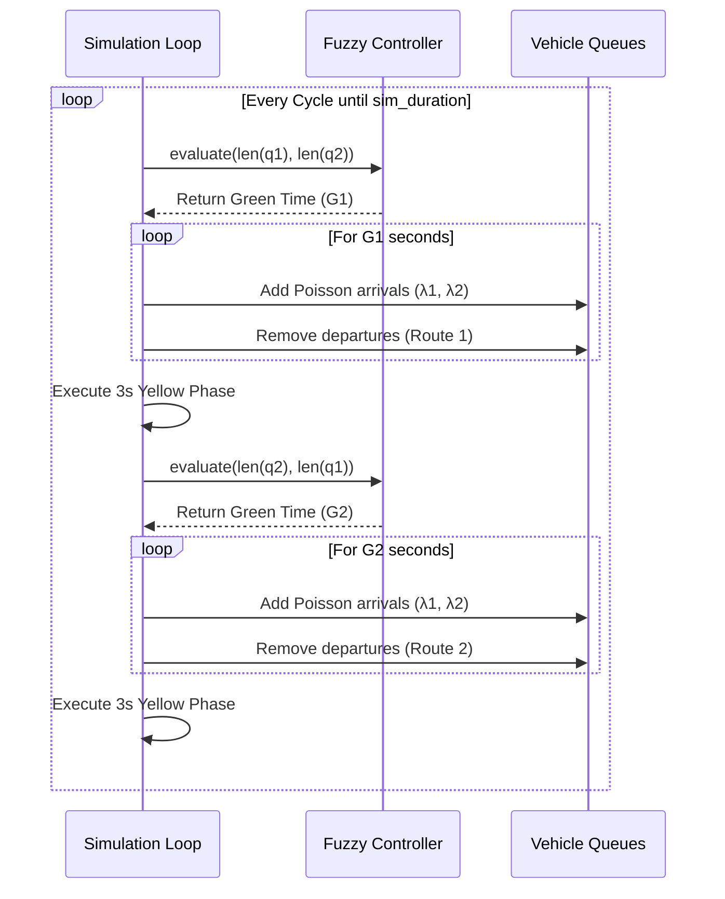

# Comprehensive Code & Algorithm Flow

This section provides a deep dive into the software architecture and algorithmic pipelines driving the Adaptive Traffic Light Controller (ATLC). It traces the execution path from the high-level simulation loop down to the mathematical optimizations.

---

## 1. Simulation Engine Pipeline (`simulation.py`)
The simulation engine acts as the discrete-time environment. It drives the vehicle arrivals and queries the AI controller to determine traffic light phases.

### High-Level Flow
1. **Initialization:** The simulation initializes vehicle tracking queues (`q1`, `q2`) and sets the `sim_duration` (default 1200 seconds).
2. **Controller Query (Route 1):** The simulation queries the `FuzzyController` by passing the current lengths of `q1` and `q2`.
3. **Phase Execution:** The controller returns a green time $G_1$. The simulation steps forward second-by-second, generating new vehicles (via a Poisson distribution) and departing vehicles at the `discharge_rate`.
4. **Yellow Phase:** A static 3-second yellow clearance phase is executed.
5. **Controller Query (Route 2):** The simulation flips the inputs, querying the controller with `(q2, q1)` to evaluate the priority of the cross-traffic and determine $G_2$.



---

## 2. Fuzzy Controller Inference Engine (`fuzzy_controller.py`)

The `FuzzyController` maps the physical parameters provided by the optimizers into a fully vectorized Mamdani inference engine.

### 2.1 Initialization & Caching (`set_parameters`)
To maximize performance (yielding evaluation times of $<0.1$ ms per loop), the controller precomputes the output membership arrays upon receiving parameters:
* It reads flat array elements `x[0:3]` for the input boundaries (`p1, p2, p3`).
* It mathematically precalculates `mu_short_arr`, `mu_med_arr`, and `mu_long_arr` across a 100-point discretization grid spanning `[G_min, G_max]`.

### 2.2 Inference (`evaluate`)
When queried by the simulation loop, it executes standard Mamdani logic:
1. **Fuzzification:** It calculates the geometric membership values for Low, Medium, and High using standard trapezoidal logic (e.g., `_membership_medium`).
2. **Rule Composition:** It iterates over the 9 core intersection rules. The "firing strength" is computed using the strict `min(mu_q1, mu_q2)` condition, multiplied by the rule's optimized `rule_weight`.
3. **Vectorized Defuzzification:** It aggregates the 100-point output grid using rapid NumPy operations rather than slow Python loops:
   ```python
   mu_agg = np.maximum(
       np.minimum(set_activations[0], self.mu_short_arr),
       np.maximum(
           np.minimum(set_activations[1], self.mu_med_arr),
           np.minimum(set_activations[2], self.mu_long_arr)
       )
   )
   ```
4. **Centroid Integration:** It computes the mathematical Center of Gravity of `mu_agg` to convert the fuzzy curve back into a crisp integer (seconds of green time).

---

## 3. Particle Swarm Optimization (`pso_optimizer.py`)

The PSO algorithm initializes a swarm of 30 particles. Each particle contains 15 dimensions representing a unique configuration of the fuzzy controller.

### The PSO Update Loop
For every particle in the swarm, across 50 generations:
1. **Velocity Update:** The particle's trajectory is updated by pulling it towards its personal best memory (`self.P[i]`) and the swarm's global best position (`self.g_best`):
   ```python
   self.V[i] = w * self.V[i] + c1 * r1 * (self.P[i] - self.X[i]) + c2 * r2 * (self.g_best - self.X[i])
   ```
2. **Position Update:** The new velocity is added to the current position (`self.X[i]`).
3. **Symmetry Breaking (Crucial):** To prevent the swarm from suffering *permutation collapse*, the script forcefully sorts the membership coordinates to bind them into a single mathematical wedge:
   ```python
   self.X[i, 0:3] = np.sort(self.X[i, 0:3])
   self.X[i, 3:6] = np.sort(self.X[i, 3:6])
   ```
4. **Evaluation:** The particle's new configuration is injected into the Simulation Engine. If the new traffic cost is lower than its previous best, it updates its memory.

---

## 4. Ant Colony Optimization (`aco_optimizer.py`)

Unlike PSO which operates in continuous vector space, ACO is a discrete grid-based algorithm. The 15-dimensional search space is split into 30 physical "bins". Ants navigate this grid probabilistically based on pheromone trails (`self.tau`).

### The ACO Update Loop
1. **Probabilistic Selection:** Each ant selects a bin for each parameter dimension. The probability is heavily dictated by pheromone concentrations:
   ```python
   p_tau = self.tau[d] ** self.alpha
   probs = p_tau / np.sum(p_tau)
   bin_choice = np.random.choice(self.num_bins, p=probs)
   ```
2. **Stochastic Discretization:** To ensure smooth continuous searching, the ant randomly samples a floating-point value from within the exact geometric boundaries of the chosen bin.
3. **Symmetry Breaking:** Just like PSO, the continuous coordinates are sorted. *Crucially, the script then recalculates the ant's bin choices to match the newly sorted coordinates*, ensuring pheromones are correctly mapped!
4. **Elitist Deposit:** Only the **Top 3 ants** of the generation are allowed to deposit pheromones back onto the grid, heavily encouraging rapid convergence.
5. **MMAS Limits:** To completely prevent premature stagnation, pheromones are strictly clipped using a Max-Min Ant System structure:
   ```python
   self.tau = np.clip(self.tau, 0.1, 5.0)
   ```
   This maintains a maximum probability ratio of $50:1$. This guarantees that while good bins are highly favored, the ants retain a mathematical probability to continue exploring across all 50 generations!
