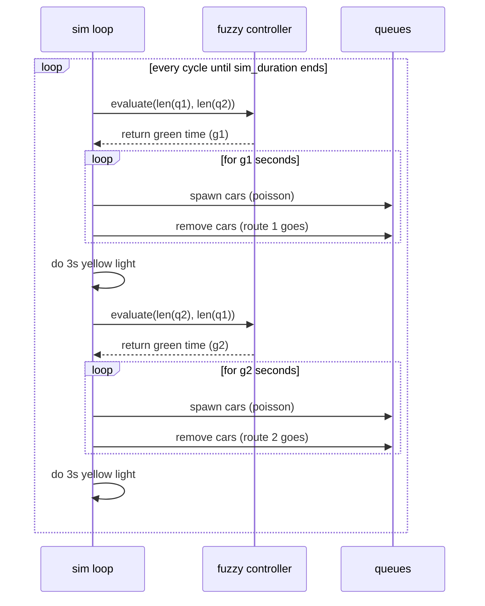

# code & algorithm flow

this page is just a deeper dive into how the code and math actually run under the hood for the atlc project. i'll try to trace it from the main simulation loop down to the optimization stuff.

---

## 1. simulation engine (`simulation.py`)
the simulation engine is basically the fake world. it spawns the cars and asks the ai controller how long the lights should be green.

### how it loops

1. **setup:** first, it sets up the vehicle queues (`q1`, `q2`) and sets the `sim_duration` (usually 1200 seconds).
2. **ask controller (route 1):** it passes the current lengths of `q1` and `q2` to the `fuzzycontroller`.
3. **run phase:** the controller spits back a green time $g_1$. the sim then loops second-by-second, adding new cars (using some poisson math) and letting cars drive away.
4. **yellow light:** we throw in a hardcoded 3-second yellow light phase.
5. **ask controller (route 2):** then it flips the inputs, sending `(q2, q1)` to the controller to figure out $g_2$ for the other road.



---

## 2. fuzzy controller (`fuzzy_controller.py`)

the `fuzzycontroller` takes the numbers from the optimizers and runs the mamdani logic.

### 2.1 setup & caching (`set_parameters`)
to make this thing run fast (like <0.1 ms per loop), i precalculated the output arrays as soon as it gets the parameters:

* it grabs the first three numbers `x[0:3]` to use as the input boundaries (`p1, p2, p3`).
* it does the math to build `mu_short_arr`, `mu_med_arr`, and `mu_long_arr` over a 100-point grid between `g_min` and `g_max`.

### 2.2 figuring it out (`evaluate`)
when the sim asks for a green time, it does the standard mamdani steps:

1. **fuzzification:** it finds out how much the inputs belong to low, medium, and high using some trapezoid math (like `_membership_medium`).
2. **rules:** it loops through the 9 intersection rules. the "firing strength" just takes the strict `min(mu_q1, mu_q2)` condition, and multiplies it by the rule's weight.
3. **fast defuzzification:** it smooshes the 100-point output grids together using numpy instead of slow python loops:
   ```python
   mu_agg = np.maximum(
       np.minimum(set_activations[0], self.mu_short_arr),
       np.maximum(
           np.minimum(set_activations[1], self.mu_med_arr),
           np.minimum(set_activations[2], self.mu_long_arr)
       )
   )
   ```
4. **centroid:** it finds the center of gravity of `mu_agg` to turn that fuzzy curve back into a solid integer for the green time.

---

## 3. particle swarm optimization (`pso_optimizer.py`)

pso boots up a swarm of 30 particles. each particle is a 15-dimensional array that represents one possible setup for the fuzzy controller.

### the pso loop
for every particle, over 50 rounds:

1. **update speed:** the particle changes direction by moving toward its personal best (`self.p[i]`) and the swarm's global best (`self.g_best`):
   ```python
   self.v[i] = w * self.v[i] + c1 * r1 * (self.p[i] - self.x[i]) + c2 * r2 * (self.g_best - self.x[i])
   ```
2. **update spot:** it adds the speed to its current spot (`self.x[i]`).
3. **the symmetry fix:** to stop the swarm from getting confused and collapsing, we forcefully sort the coordinates so they stay in a neat math wedge:
   ```python
   self.x[i, 0:3] = np.sort(self.x[i, 0:3])
   self.x[i, 3:6] = np.sort(self.x[i, 3:6])
   ```
4. **test it:** we run the particle's setup in the simulation. if it gets a better traffic cost, it remembers it.

---

## 4. ant colony optimization (`aco_optimizer.py`)

while pso flies around in continuous math space, aco uses a grid. i split the 15 dimensions into 30 little "bins". the ants walk through this grid based on pheromone trails (`self.tau`).

### the aco loop

1. **pick a path:** each ant picks a bin for each parameter. the choice is mostly driven by the pheromones:
   ```python
   p_tau = self.tau[d] ** self.alpha
   probs = p_tau / np.sum(p_tau)
   bin_choice = np.random.choice(self.num_bins, p=probs)
   ```
2. **random spot in bin:** to keep the search smooth, the ant picks a random float from inside that specific bin.
3. **symmetry fix:** just like pso, we sort the coordinates. but then we have to *recalculate* the ant's bin choices to match the newly sorted coordinates, so the pheromones get dropped in the right place!
4. **elitist drop:** only the top 3 ants of the round get to drop pheromones, which forces them to converge faster.
5. **mmas clipping:** to stop them from getting stuck, i clipped the pheromones using max-min ant system logic:
   ```python
   self.tau = np.clip(self.tau, 0.1, 5.0)
   ```
   this keeps the probability ratio at 50:1 max. basically, good bins are favored, but the ants always have a small chance to explore somewhere else.
