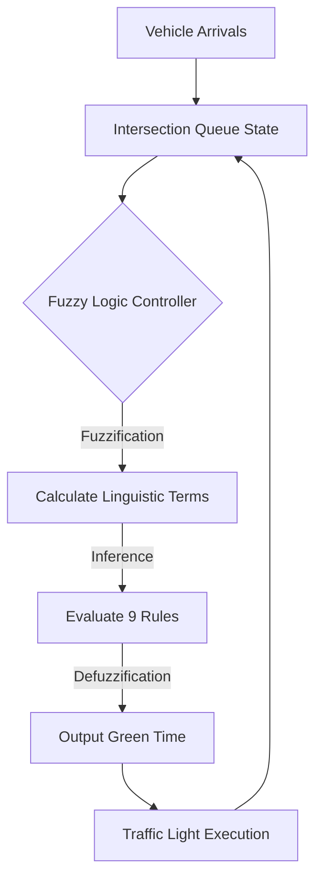

# How It Works (Fuzzy Logic)

Our traffic controller doesn't just use simple IF/ELSE statements. It uses **Fuzzy Logic**, which allows it to mathematically handle real-world uncertainty perfectly.

## The Goal
The intersection has two main routes. The goal is to minimize a combination of three things:

1. **Average Wait Time ($W$)**
2. **Average Queue Length ($Q$)**
3. **Number of Vehicle Stops ($S$)**

We combine these into a single "Cost" score: $Cost = 0.5W + 0.3Q + 0.2S$. The lower the cost, the better the traffic flows!

## What is Fuzzy Logic?
Normally, a queue is just an exact number (like 12 cars). In Fuzzy Logic, we convert this exact number into "linguistic terms" just like a human would.
For example, 12 cars might be 80% "High" and 20% "Medium". 

Our system does this in three steps:

### 1. Fuzzification
We look at the queue length on Route 1 and Route 2, and categorize them into **Low**, **Medium**, or **High** based on geometric boundaries (triangles and trapezoids).

### 2. Rule Evaluation
We apply 9 common-sense rules to make a decision. For example:
* *IF Route 1 has a High queue AND Route 2 has a Low queue, THEN give Route 1 a Long green light.*
* *IF both routes have a Medium queue, THEN give them a Medium green light.*

### 3. Defuzzification
The rules output a "fuzzy" green light recommendation (e.g., "mostly Long, slightly Medium"). We use mathematical integration (the Center of Gravity method) to convert this back into an exact number of seconds (e.g., 42 seconds) to keep the green light on.

## System Architecture Loop
The controller evaluates the intersection continuously in a tight feedback loop:

## Why Optimization?
The definitions of "Low", "Medium", and "High" are determined by those geometric boundaries. But what exactly counts as a "High" queue? 10 cars? 20 cars? 
If we guess these boundaries manually, the system won't be perfect. Instead, we use **AI Optimization Algorithms** to find the absolute mathematically perfect boundaries!
