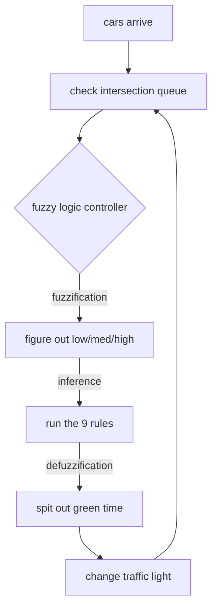

# how it works (fuzzy logic)

so our traffic controller doesn't just use basic if/else statements. we used fuzzy logic, which is cooler because it handles real-world uncertainty a lot better.

## what we want to do
the intersection has two main roads. the whole point of this is to minimize three things:

1. average wait time ($w$)
2. average queue length ($q$)
3. number of times cars have to stop ($s$)

i just combined these into one "cost" score: $cost = 0.5w + 0.3q + 0.2s$. basically, lower cost means the traffic is flowing better!

## so what is fuzzy logic?
normally, a queue is just a hard number (like 12 cars). but in fuzzy logic, we turn this number into words, kind of like how a real person would describe it.
so instead of "12 cars", we might say it's 80% "high" and 20% "medium". 

we do this in three main steps:

### 1. fuzzification
first, we check the queue length on route 1 and route 2, and sort them into low, medium, or high using some math shapes (triangles and trapezoids).

### 2. rule evaluation
then we use 9 simple rules to figure out what to do. for example:
* if route 1 has a high queue and route 2 has a low queue, then give route 1 a long green light.
* if both roads have a medium queue, then give them a medium green light.

### 3. defuzzification
the rules spit out a "fuzzy" green light idea (like, "mostly long, but a bit medium"). we use some math integration (the center of gravity method) to turn this back into an actual number of seconds, like 42 seconds, for the green light.

## how the system loops
the controller is constantly checking the intersection in a loop:

## why do we need optimization?
the thing is, what actually counts as a "high" queue? is it 10 cars? 20 cars? we define these using the shapes from earlier.
if we just guess the boundaries ourselves, it's not going to be perfect. so instead, i used ai optimization algorithms to figure out the exact mathematical best boundaries for us.
