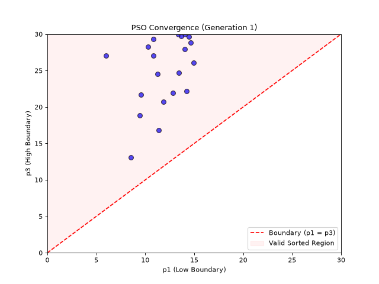

# Optimization Algorithms

To make our Fuzzy Logic Controller as efficient as possible, we need to tune 15 internal parameters. These parameters represent the shapes of the fuzzy boundaries and the importance weights of the rules.

We tested two different **Population-Based Metaheuristic** algorithms. These algorithms are inspired by nature and involve a "population" of agents working together to find the best possible configuration.

## 1. Particle Swarm Optimization (PSO)
Inspired by a flock of birds, PSO creates a swarm of 30 "particles." Each particle represents a guessed configuration of the traffic light.

* The particles fly through the mathematical search space.
* They remember their own personal best configuration.
* They communicate with the swarm to know the global best configuration.
* Over 50 generations, they adjust their flight paths, homing in on the absolute perfect traffic light parameters.

## 2. Ant Colony Optimization (ACO)
Inspired by how ants find the shortest path to food, ACO uses 30 "ants" to build configurations step-by-step.

* We divide the search space into a grid (30 bins per parameter).
* When an ant finds a good configuration (low traffic cost), it deposits "pheromones" on those grid bins.
* Future ants are probabilistically attracted to bins with high pheromones.
* Over time, bad paths evaporate, and the entire colony converges on the optimal configuration.

---

## Technical Innovation: Breaking the Permutation Symmetry
During our research, we found a mathematical challenge: the fuzzy parameters have *permutation symmetry* (e.g., swapping the boundaries for "Low" and "Medium" evaluates exactly the same). If left unchecked, this confuses the ants and birds, causing them to deposit contradictory pheromones or collapse their search! 

We fixed this by mathematically forcing all coordinates into a sorted wedge ($x_0 \le x_1 \le x_2$). This simple but powerful fix unlocked incredibly fast, robust, and smooth convergence for both algorithms, completely eliminating premature stagnation.

**Watch the AI learn!** Below is a real-time animation of the PSO swarm over 20 generations. Notice how the particles (blue dots) rapidly confine themselves to the valid sorted region (the red wedge) and beautifully converge on the optimal solution.

