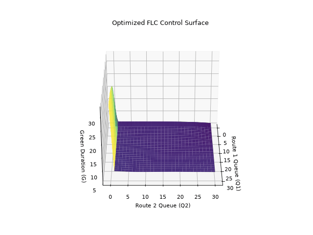
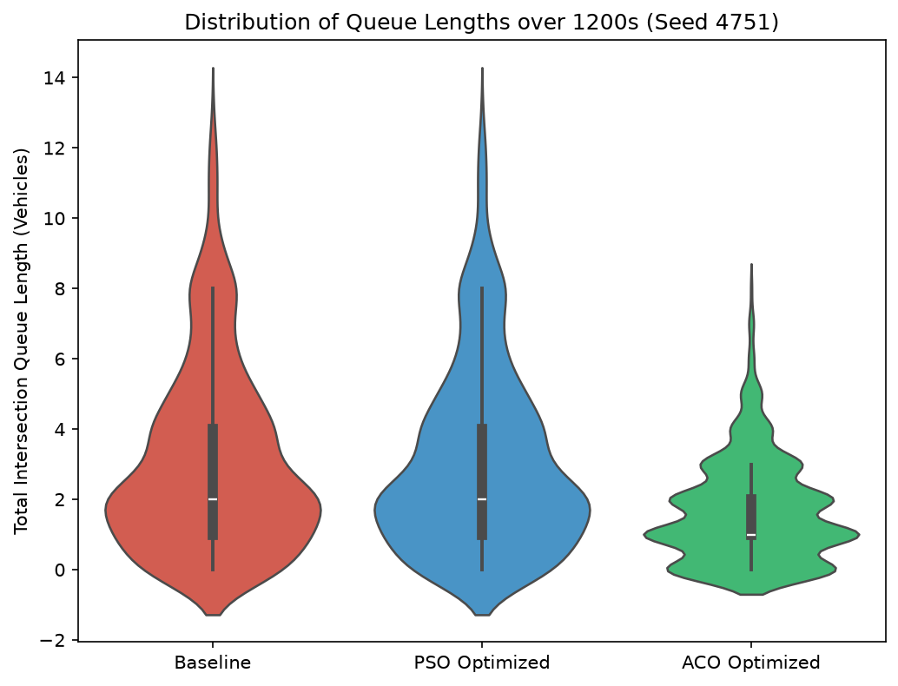
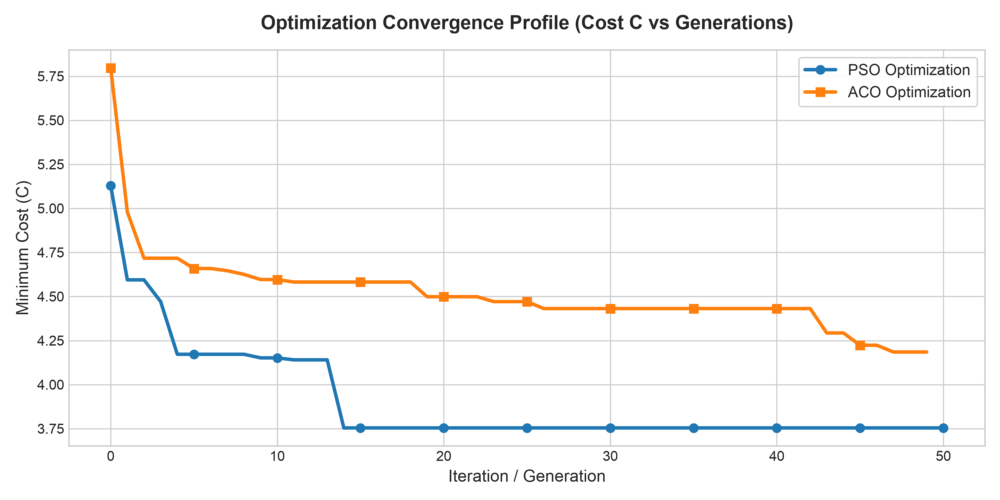
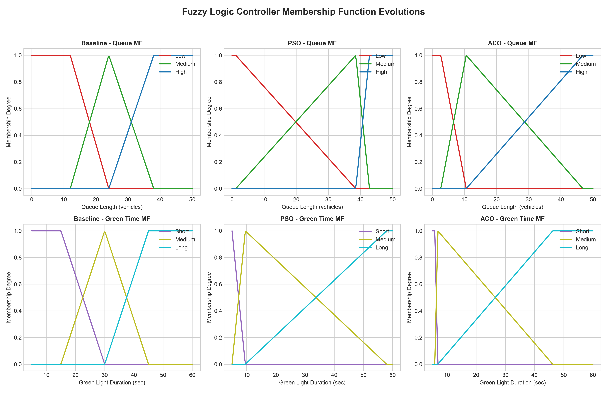
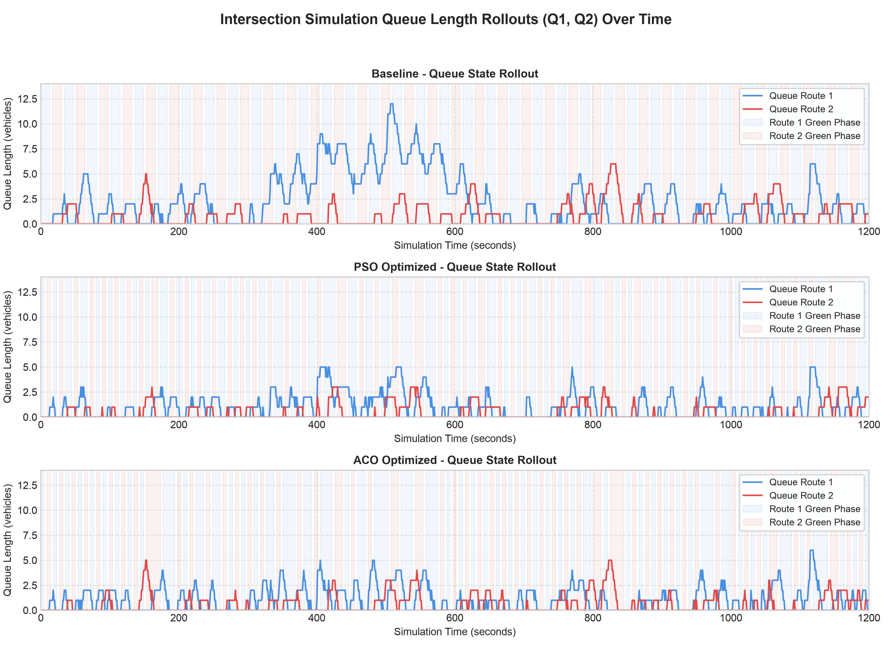

# performance results

i ran tests on our optimized controllers compared to a basic manual setup. i used a really heavy, jammed traffic scenario (seed 4751) and let the simulation run for 1200 seconds.

## 1. the raw numbers

| metric / parameter | baseline (initial) | pso optimized | aco optimized | improvement |
| :--- | :--- | :--- | :--- | :--- |
| **lowest cost ($c$)** | 7.7490 | 3.9264 | 4.1742 | **~ 50% better** |
| **avg wait time ($w$)** | 14.22 s | 7.08 s | 7.55 s | **~ 50% less wait** |
| **avg queue length ($q$)** | 1.55 veh | 0.77 veh | 0.82 veh | **~ 50% shorter** |
| **avg stops ($s$)** | 86.26% | 75.19% | 74.05% | **~ 14% fewer** |

as you can see, both algorithms totally crushed it and **cut the average wait times and queue lengths in half**!

---

## 2. some cool graphs

### optimized 3d control surface
this 3d surface shows the "brain" of the ai. it shows exactly how the controller picks the green light time based on how long the queues are on route 1 and route 2. the smooth, curvy terrain shows that fuzzy logic handles weird edge-cases way better than a dumb timer.

### queue length distribution (violin plot)
averages are cool, but this violin plot shows the whole spread of queue lengths over the 1200 seconds. the baseline model has this long "tail" which basically means huge traffic jams happened randomly. but the pso and aco models completely killed that tail, keeping the queues near zero most of the time!

### optimization convergence profile
this chart proves the algorithms weren't just making lucky guesses. over 50 generations, you can see the cost dropping smoothly as the swarms and colonies figured out how to handle traffic better. since it doesn't just flatline early, it proves that our permutation symmetry fix actually worked!

### fuzzy membership boundary evolutions
this just shows how the ai took our human definitions of "low", "medium", and "high" queues and tweaked them to perfectly match the math of the traffic. 

### intersection queue state rollouts
this is a second-by-second playback of the queue lengths. the blue and red shaded parts are when the green light was on for that route. notice how the optimized ones keep the spikes way lower than the baseline!

